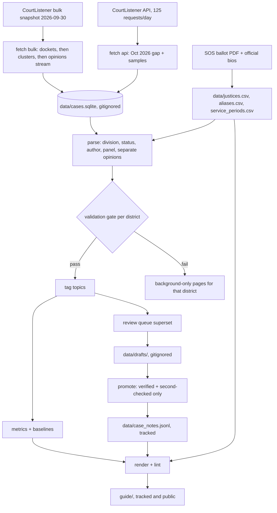
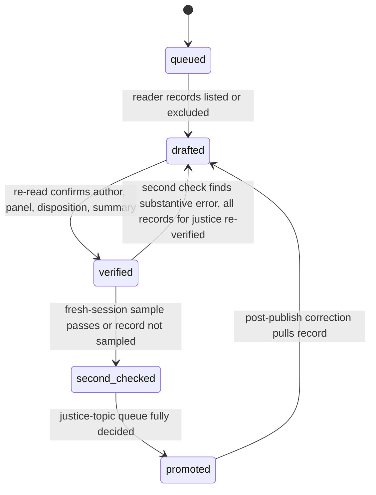
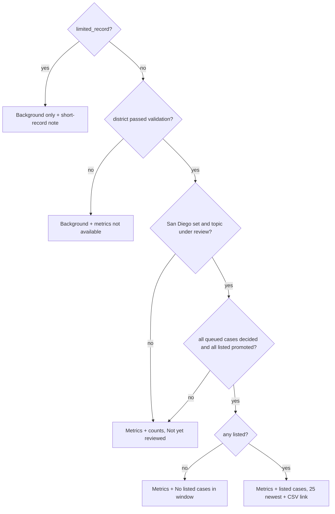

# California Appellate Retention Guide Phase 1 - Plan

## Goal Capsule

- **Objective:** By the morning of Tuesday, October 27, 2026, any California voter can open a neutral, source-linked page for each of the 64 appellate justices on the November 3 retention ballot. The 17 justices on San Diego County ballots also get hand-verified search-and-seizure case lists. No unverified claim about a named judge is ever published, including through the public repository.
- **Means:** Stream-filter CourtListener's bulk data snapshot into SQLite, parse and validate it, compute metrics with baselines, then verify listed cases by agent reading and render deterministic Markdown into a public GitHub repo (KTD1, KTD2, KTD6).
- **Authority:** `SPEC.md` is the source of truth for product rules. This plan records how Phase 1 is built and where research forced a change to the spec. Every such change is logged in `DECISIONS.md` and patched into `SPEC.md` in U1 (see the Spec Deviations table under Planning Contract). When this plan and `SPEC.md` disagree on a product rule that is not in that table, `SPEC.md` wins.
- **Stop conditions:**
  - A token, `.env` value, raw cache, SQLite file, or unverified case record reaches a pushed commit. Stop all pushes, rotate the token if one leaked, and purge the history before continuing.
  - The parsing validation gate (R9) has not passed by end of day Wednesday, October 21. Any district whose own stratum still fails at that point ships its justices with background facts and a "metrics not available" note (KTD10); work continues on the others.
  - Freeze is the morning of October 27. Anything not verified at that point renders as "Not yet reviewed", and nothing is estimated (R20).
- **Execution profile:** Solo owner plus Claude sessions in a single public repo. The work is a mix of code units and operational units: U10 is reading and verification work rather than code, and U12 is release work plus a small acceptance script.
- **Who finishes and ships:** The owner. The owner approves the public repo creation, the window decision (R6), the 10-summary spot check (R18), and the final publish.

---

## Product Contract

### Summary

Build a Python pipeline and a Markdown voter guide covering all 64 ballot justices. Every justice gets background facts and automated metrics with baselines. The 17 San Diego-ballot justices get verified Tier 1 (`search_seizure`) case lists. Tier 2 is a stretch goal, and Phase 2 work is deferred. The repo is public from the first commit, so committed data is limited to verified records and only the guard checks can approve what gets in.

### Problem Frame

California voters cast yes/no retention votes on appellate justices with almost no information. The guide must work equally for a voter who wants judges to check government power and one who wants judges to defer to law enforcement. It does that by describing what each justice did, with links, and never grading them (see `SPEC.md` §1–2). The worst failure is a wrong summary attached to a real judge's name. Accuracy gates therefore outrank coverage, and a "not yet reviewed" page is an acceptable outcome.

Two facts discovered during planning change how the spec gets built. First, CourtListener cut free authenticated API access on May 7, 2026 to 5 requests/min, 50/hour, and 125/day, so the spec's API-first fetch at about 1 request/second cannot finish 40,000 opinions in time. Second, the owner wants the repo public from day one, which turns every push into publication. Ground rule 4 ("anything not verified does not ship") then has to be enforced by tooling rather than by convention.

### Requirements

**Ballot and background**

- R1. `data/justices.csv` lists all 64 ballot justices with names copied exactly from the SOS judicial candidates PDF. Every non-blank background field has a source URL, and the 17 San Diego-ballot justices are completed first (`SPEC.md` §4, §7.1, §8.1).
- R2. Justices with less than 12 months of appellate service, counted from their first appellate date, are flagged `limited_record`. Their pages give background only and say plainly that the appellate record is too short to assess (`SPEC.md` §4).
- R3. Each justice's service history (court, district, division, title, start, end) is recorded so name resolution, windows, and baselines handle elevations, transfers, and assignments (KTD4).

**Data acquisition**

- R4. Every California Court of Appeal opinion (`calctapp`) filed from the window start through the run date, and every Supreme Court opinion (`cal`) from 2019 onward, is stored in `data/cases.sqlite` with its source link. Both published and unpublished opinions are included (KTD1).
- R5. All acquisition steps are idempotent and resumable. A rerun does no redundant downloading or API calls (`SPEC.md` §6.3).
- R6. On day one, a coverage report gives opinion counts per year, court, and publication status. The owner decides the window from that report: keep 2020 onward, or cut to 2023 onward. The decision and the coverage numbers are logged in `DECISIONS.md` and shown on the methodology page.

**Parsing and validation**

- R7. Each opinion is parsed for district, division, publication status, author, per curiam, panel, assigned judges, and separate opinions (including partial dissents) (`SPEC.md` §7.3).
- R8. Names resolve on surname alias plus district, division, and service dates, never surname alone. Unresolved matches go to a review queue and are never guessed.
- R9. Metrics are not computed until a stratified validation sample of at least 200 opinions passes the `SPEC.md` §7.3.8 thresholds: author ≥ 98%, panel membership ≥ 97%, separate-opinion detection ≥ 95%. The labels come from a session that did not write the parser (KTD10).
- R10. Tier 1 topic tagging reaches ≥ 85% precision on a hand-checked sample of 50, under the precision definition in KTD9.

**Metrics**

- R11. For every justice, the guide computes volume, publication rate, separate opinions (count and per 100 panels), topic counts, and contested votes. Every rate appears next to its baseline and the baseline's N (KTD5).

**Case listing and verification**

- R12. For each San Diego-ballot justice and each Tier 1 topic, every case meeting listing rules L1–L4 (plus the Supreme Court rule in `SPEC.md` §8.4) is listed. The listing is applied identically to every justice (KTD7).
- R13. Every queued case gets a recorded decision, listed or excluded. Each exclusion has a reason from a fixed list (KTD7).
- R14. Each listed case has a record matching the `SPEC.md` §8.5 schema plus the KTD7 fields. Its summary follows the `SPEC.md` §10 style guide, and it is verified against the opinion text before it can be committed.
- R15. A fresh session re-checks a random 15% of each justice's decided records, listed and excluded, with at least one per justice. Any substantive error triggers re-verification of all of that justice's records and a `DECISIONS.md` entry giving the error type (KTD8).

**Publication and the public repo**

- R16. The public repo never contains a token, `.env`, raw cache, SQLite file, unverified case record, or unverified rendered summary at any commit (KTD2).
- R17. The guide renders `guide/index.md`, `guide/methodology.md`, `guide/justices/<slug>.md`, and the CSV exports in `guide/data/` according to `SPEC.md` §12. The index is never sorted by an outcome measure.
- R18. Before publication, the owner reads 10 random summaries, drawn from the final shippable set, against their opinions.
- R19. The render step fails if any page contains a banned word from `SPEC.md` §10, with matching limited to prose the project wrote (KTD11).
- R20. At freeze, a justice-topic shows listed cases only if every queued case for it is decided and every listed record is verified and second-checked. Otherwise it shows "Not yet reviewed" (KTD6).
- R21. Every justice page shows the data window, the snapshot date, and the limitations note. The methodology page carries the `SPEC.md` §11 limitations, the validation results, the coverage report, the AI-assistance disclosure, and a CourtListener credit.
- R22. The Groban and Evans pages quote the *At the Lectern* figures for dissents from denial of review, attributed and linked as a third-party compilation, not restated as the project's own measurement (`SPEC.md` §5.3, §8.4).

### Success Criteria

- On October 27, all 64 justice pages exist. All 17 San Diego-ballot pages show either verified Tier 1 listings or an explicit "Not yet reviewed". The `SPEC.md` §13 acceptance checklist passes.
- No secret or unverified record appears anywhere in the public repo's git history (checked by the history scan in U12).
- Rendering twice from the same data produces byte-identical output.

### Key Decisions

- **Public GitHub repo from the first commit.** This was the owner's direction. It conflicts with ground rule 4 unless tooling keeps drafts out of git, so KTD2 adds a gitignored drafts area, a single promotion path, and pre-commit and CI guards. Governs R16, R20.
- **The empty `judges` folder is the repo root, not a nested `retention-guide/`.** (session-settled: user-approved — chosen over creating `retention-guide/` as the spec's layout shows: the folder was already created for this project.) Governs R5.
- **Claude sessions read and verify cases, with a fresh-session 15% re-check and the owner's 10-summary spot check as the final gate.** The owner does not read every summary. (session-settled: user-approved — chosen over owner-read verification of every summary: the October 27 deadline doesn't leave time for that.) Governs R14, R15, R18.
- **Keep the 2020-onward window by default, with an explicit owner decision point on day one.** (session-settled: user-approved — chosen over cutting to 2023 up front: keep the larger record unless evidence says otherwise.) Research found that download speed no longer drives this decision once bulk data is the source; per-year coverage does. R6 therefore makes the coverage report the evidence for the decision. Governs R6.
- **Topic counts for Tier 2 and Tier 3 are published, but labeled as unvalidated keyword matches.** `SPEC.md` §3 asks for counts on every topic, while validation covers only Tier 1 (and Tier 2 if time allows). The plan builds what the spec asks for and labels the difference. Open Question Q3 asks whether the owner would rather omit them. Governs R11, R17.

### Scope Boundaries

- Not in Phase 1: verified summaries for the 47 justices outside San Diego, verified listings for Tier 3 topics (their counts still ship, per the Key Decision above), API-assisted classification (`SPEC.md` §9.2), Supreme Court review and depublication tracking, and Form 700 data.
- Tier 2 verified summaries for the 17 San Diego-ballot justices are a stretch goal. They're attempted only if Tier 1 for all 17 is verified and second-checked by Sunday, October 25.
- The publishing venue, final project name, and correction-contact email are owner decisions (`SPEC.md` §16). The plan leaves placeholders in the methodology template and puts these on the acceptance checklist.
- No contact with judges, courts, or campaigns (`SPEC.md` §2.7).
- Considered and not built:
  - **A private companion repo for drafts.** A gitignored local drafts folder meets R16 for a single operator. A private repo becomes worth it only if a second person needs the drafts.
  - **Automated HTTP link checking against courtlistener.com.** Anonymous requests return 202 with an empty body, and authenticated checks would spend the 125/day budget. Bulk data already proves each cluster exists, and U12 adds a browser spot check. A wave of dead links reported after launch would change this.
  - **Paid CourtListener membership.** The top tier still allows only 1,400 requests/day, which is too slow to replace bulk data. It would only speed up the October top-up, which is already small.
  - **A persisted multi-tier API rate budget.** Total API volume is under about 100 requests. A fixed interval between requests plus the `Retry-After` stop rule (U4) stays under every documented limit. A need for sustained API use would change this.

#### Deferred to Follow-Up Work

- Phase 2 backlog (`SPEC.md` §15).
- A county-to-district lookup on the index for voters who know their county but not their district.
- Making the pipeline reusable for the 2028 ballot, starting from the ballot list as an input file.

### Sources

- `SPEC.md` (origin; copied into the repo root in U1).
- CourtListener v4 API overview, which gives the rate limits: https://wiki.free.law/c/courtlistener/help/api/rest/v4/overview
- CourtListener case-law endpoints and query refinement (`fields=`, `order_by=id` cursor pagination, text fields): https://wiki.free.law/c/courtlistener/help/api/rest/v4/case-law and https://wiki.free.law/c/courtlistener/help/api/rest/v4/query-refinement
- CourtListener bulk data documentation: https://wiki.free.law/c/courtlistener/help/api/bulk-data/bulk-legal-data
- The rate-limit announcement: https://free.law/2026/05/07/api-included-in-memberships/
- SOS judicial candidates list: https://elections.cdn.sos.ca.gov/statewide-elections/2026-general/judicial.pdf

---

## Planning Contract

### Key Technical Decisions

- KTD1. **CourtListener's bulk data snapshot is the primary opinion source. The API covers only the October gap, samples, and spot checks.**
  - **Snapshot:** the quarterly bulk snapshot dated 2026-09-30, in S3 bucket `com-courtlistener-storage`, prefix `bulk-data/`, as `*.csv.bz2` files. The opinions file is about 55 GB compressed, clusters about 2.5 GB, and dockets about 5.1 GB.
  - **Filter order:** dockets by `court_id` in {`calctapp`, `cal`}, then clusters by docket and `date_filed`, then the opinions file streamed once, keeping rows whose `cluster_id` is in the set.
  - **October gap:** opinions filed from 2026-10-01 to the run date come through the API list endpoint with `fields=` and `order_by=id`, at about 20 opinions per request.
  - **Why:** the documented free limit of 125 requests/day makes 40,000 opinions (about 2,000 list pages) a 16-day job. Bulk data is free, needs no token, and fits on disk (180 GB free).
  - **Rejected:** API-first at about 1 request/second, which is infeasible, and paid membership, which is still too slow at 1,400/day.
  - **Exception:** if the owner's API Usage page shows the account was grandfathered at the old 5,000/hour limit, the API may be used for the gap and for checks more freely. The design doesn't change.
- KTD2. **Drafts never enter git. A single promotion command is the only writer of tracked case records.**
  - **Drafts:** working case records live in `data/drafts/` (gitignored).
  - **Promotion:** `python -m src.review promote` copies a justice-topic's records, listed and excluded, into tracked `data/case_notes.jsonl` only when every record is verified and that justice's second check (KTD8) has passed.
  - **Guards:** `src/guard.py` runs as a pre-commit hook and a pre-push hook, which are the preventive layers, and again in CI. The guard fails if any tracked case record lacks `verified: true` or has a `second_check` other than `passed` or `not_sampled`, or if any file under `guide/` cites a cl_opinion_id that isn't in `data/case_notes.jsonl`. CI runs after a push is already public, so it is a detection layer that triggers the leak stop condition, not a prevention.
  - **Secret scanning:** the guard fails if the exact local value of `COURTLISTENER_TOKEN` appears in any staged, pushed, or tracked file, without ever printing the value. gitleaks runs as a second layer with custom rules for `COURTLISTENER_TOKEN=`, `Authorization` header forms (including quoted dict keys), and `token=` query strings. CourtListener tokens are 40-character hex strings with no prefix, so GitHub push protection probably won't recognize them, and a bare-hex rule would fire on every git SHA.
  - **Contact email:** the User-Agent contact address comes from `.env` (`CL_CONTACT_EMAIL`), not `config.yaml`, so a personal email is never committed.
- KTD3. **Use one SQLite database with explicit tables for opinions, panel seats, separate opinions, topic tags, and the fetch log.** Raw downloads live under `data/raw/` and are gitignored. The `opinions` columns follow `SPEC.md` §7.2. Panel seats and separate opinions get their own tables rather than JSON columns, so metrics come from plain SQL. Each opinion row stores its source (`bulk-2026-09-30` or `api`) and a text hash, which handles deduplication and rerun detection.
- KTD4. **Add `data/service_periods.csv` (slug, court, district, division, title, start, end, source_url) alongside `justices.csv`, and a `data/other_justices.csv` roster of non-ballot justices.**
  - **Use:** the resolver matches a signature to a justice only when the opinion's district, division, and date fall inside one of that justice's service periods.
  - **Non-ballot roster:** most panel seats belong to judges not on this ballot: the other Supreme Court justices, sitting justices not up for retention, and former justices. Those judges get slugs in `other_justices.csv` with service periods and aliases, so their signatures resolve instead of flooding the unresolved queue. This also makes the same-surname collisions with former justices from `SPEC.md` §7.3.7 resolvable, and it gives the panel-membership gate a full ground truth. `justices.csv` stays at exactly the 64 ballot justices.
  - **Assignments:** cross-division or cross-district assignments resolve only when the opinion text contains assignment language.
  - **Why:** without this table, elevations (for example, Rashida A. Adams becoming Presiding Justice) and 4th District cross-division transfers misresolve exactly the San Diego set. Adding it later would change a stored data format.
- KTD5. **Baselines are pooled rates over every opinion decided by the same division in the same period as the justice.**
  - **Unit:** the division is the deciding panel's division from the caption header, with the docket prefix as fallback and disagreements logged. The unit is the district for the 3rd, 5th, and 6th Districts, which have no divisions, and the whole court for the Supreme Court.
  - **Time-slicing:** baselines are sliced to the dates the justice actually sat in that division. The justice's own opinions are included, and the baseline N is shown.
  - **Supreme Court:** publication rate is omitted, since every Supreme Court opinion is published, and "panels" means cases participated in.
  - **Per curiam opinions** count as a panel seat for each identified panel member but are not authored, and they are excluded from publication rates.
  - **Automated "contested votes"** means any dissent in a topic-tagged opinion, labeled that way. A split specifically on the topic issue comes only from verified L4 records.
- KTD6. **The shippable unit is the justice-topic.** Render shows a justice-topic's listed cases only when its whole queue is decided and every listed record is promoted (R20). Otherwise it renders "Not yet reviewed" and shows counts only. This prevents a partial "25 most recent" list that would not follow the listing rules.
- KTD7. **The review queue is a mechanical superset. The reader decides each case, and exclusions are recorded.**
  - **Why:** "reversed on the topic issue" (L3) and "dissent on the topic issue" (L4) can't be computed before reading.
  - **What the queue includes:** for each justice and topic, every matching opinion where the justice wrote a separate opinion (L1), every published matching majority opinion they authored (L2), every matching authored majority opinion whose disposition is anything other than a pure affirmance (L3 candidates), and every matching opinion the justice joined over a dissent (L4 candidates). For the Supreme Court, every matching majority opinion they authored is included.
  - **Queue match is recall-oriented:** for the San Diego set, an opinion matches the queue if it has any anchor or at least 1 broader-term hit, which is looser than the published tag (KTD9). Readers exclude false positives as `topic_not_at_issue`, so tightening anchors for precision never shrinks the reading queue.
  - **Schema additions:** `listing_decision` (`listed` | `excluded`), `exclusion_reason` (`topic_not_at_issue`, `topic_issue_affirmed`, `dissent_on_other_issue`, `duplicate`), and `second_check` (`pending` | `passed` | `failed` | `not_sampled`, with date and session). A case nobody has read stays undecided. It never gets an exclusion reason.
- KTD8. **The second check samples per justice, covering listed and excluded records alike.** The sample size is `max(1, ceil(0.15 × decided records))`. Drawn records get `passed` or `failed`, and the rest get `not_sampled` once every drawn record passes. A substantive error is any error in role, listing rule, disposition, outcome, vote, or holding. A justice whose re-verification is not finished at freeze reverts to "Not yet reviewed".
- KTD9. **Topic precision means the opinion addresses a claim on that topic on the merits, or rules the claim forfeited.** A passing mention in the facts doesn't count. This definition is fixed before labeling starts, and the guide labels counts as "opinions addressing …". If Tier 1 anchors miss 85% under this definition, they are tightened, and each change is logged in `DECISIONS.md`. Recall is also measured, on a seeded sample of untagged 4th District and Supreme Court criminal opinions, and published in `report_tags.md`. The queue's looser match (KTD7) protects listing completeness from tightened anchors.
- KTD10. **A separate Claude session produces the validation labels from opinion text only, with no parser output visible. The owner audits 20 of them and rules on any parser/label disagreement before it counts as a parser error.**
  - **Sample:** at least 200 opinions, stratified per `SPEC.md` §7.3.8, plus per curiam opinions, assigned judges, partial publication, and modified opinions. The 4th District gets at least 60 and the Supreme Court at least 30, because the San Diego set rests on them. About 25 opinions per district would allow zero errors at 98% and couldn't separate a real failure from one slip.
  - **Gate:** the pooled sample must meet the R9 thresholds. Every district's rate is reported. The 4th District and the Supreme Court are also gated on their own strata, stated as allowed error counts for their N.
  - **Fallback:** a gated stratum that still fails at the R9 deadline ships its justices with background facts only and a methodology note.
- KTD11. **The banned-word lint matches whole words in prose the project wrote: summaries, page templates, and the methodology page.** It skips case names and text quoted from opinions under the `SPEC.md` §10 quotation rule. Exceptions live in `data/lint_exceptions.yaml`, and each one is logged in `DECISIONS.md`.
- KTD12. **Render is deterministic.** "Last updated" comes from `snapshot_date` in `config.yaml`, never the clock. Rows sort on stable keys (date descending, then docket), and number formatting is fixed. A test renders twice and compares bytes, which keeps public diffs limited to real changes.
- KTD13. **Tooling:** `pyproject.toml` with the `SPEC.md` §6.1 dependencies, pytest, and ruff, managed with `uv` if it is installed and plain `venv` with `pip` otherwise.
  - **Licenses:** proposed MIT for code and CC BY 4.0 for the guide's original prose and data exports, pending owner confirmation before the first push (Q7). Opinions themselves are public domain, and the bulk files carry the CC Public Domain Mark.
  - **CI:** GitHub Actions runs on `pull_request` and `push` with read-only permissions and no secrets. It runs ruff, pytest, the guard, and gitleaks.

### Spec Deviations

Each row is logged in `DECISIONS.md` and patched into the repo copy of `SPEC.md` in U1.

| Spec section | Spec says | Plan does | Reason |
|---|---|---|---|
| §5.1 | API at about 1 request/second, overnight bulk run | Bulk snapshot plus API top-up (KTD1) | Documented limit of 125 requests/day |
| §6.2 | `retention-guide/` root; `case_notes.jsonl` tracked with drafts | `judges/` root; drafts gitignored, tracked file is promoted records only (KTD2) | Owner decisions: folder choice and public repo |
| §6.2 | `.gitignore` lists `.env`, `data/raw/`, `data/*.sqlite` | Also `data/drafts/`, `data/review/` | R16 |
| §7.1 | Single `appellate_start_date`, district, and division | Adds `service_periods.csv` and `other_justices.csv` (KTD4) | Elevations, transfers, and non-ballot panel members |
| §7.3.8 | 200-opinion sample, overall thresholds | Same pooled gate, plus larger 4th District and Supreme Court strata gated on their own (KTD10) | Detect a failure concentrated in the San Diego courts |
| §8.5 | Case record schema | Adds `listing_decision`, `exclusion_reason`, `second_check` (KTD7) | Recorded exclusions and per-record re-check |
| §9.1 step 4 | Random 15% overall | 15% per justice, listed and excluded (KTD8) | A small justice could otherwise get no sample |
| §13 | "Every link resolves" | Cluster existence proven by bulk data, plus a browser spot check | Anonymous scraping returns 202 |

### High-Level Technical Design

The pipeline's data flow, and where the public/private boundary sits:



The lifecycle of one queued case record. Only `promoted` reaches git:



What each justice-topic renders as at render time (KTD6, R2, R9):



### Output Structure

```text
SPEC.md
DECISIONS.md
README.md
LICENSE
LICENSE-CONTENT
config.yaml
pyproject.toml
.env.example
.gitignore
.gitleaks.toml
.pre-commit-config.yaml
.github/workflows/ci.yml
docs/plans/
data/
  justices.csv
  other_justices.csv
  aliases.csv
  service_periods.csv
  keywords.yaml
  lint_exceptions.yaml
  sc_denial_dissents.yaml
  case_notes.jsonl          # promoted records only
  validation/
  raw/                      # gitignored
  drafts/                   # gitignored
  review/                   # gitignored
  cases.sqlite              # gitignored
src/
  config.py
  db.py
  justices.py
  fetch.py
  cl_api.py
  parse.py
  resolve.py
  tag.py
  validate.py
  metrics.py
  review.py
  guard.py
  render.py
  lint.py
  acceptance.py
  templates/
tests/
  fixtures/
guide/
  index.md
  methodology.md
  justices/
  data/
```

### Sequencing

The calendar follows `SPEC.md` §14. The freeze date doesn't move.

| Dates (2026) | Units |
|---|---|
| Sat Oct 17 – Sun Oct 18 | U1, U2 (San Diego set first), U3 download started, U4 samples and October gap |
| Mon Oct 19 – Tue Oct 20 | U3 filter + coverage report (owner window decision), U5, U6, U7, U8 |
| Wed Oct 21 | Validation gate deadline (R9), U9 |
| Wed Oct 21 – Sat Oct 24 | U10 in `SPEC.md` §9.1 order: Supreme Court, 4th/1, 4th/3, 4th/2 |
| Sun Oct 25 | U11, second check, Tier 2 if ahead |
| Mon Oct 26 | U12 acceptance and owner spot check |
| Tue Oct 27 | Freeze and publish |

U5 can start before U3 finishes, using about 30 API-sampled opinions. That costs 2–3 list requests.

### Assumptions

- The 2026-09-30 snapshot includes California unpublished opinions for the window. The U3 coverage report tests this, and R6 handles thin years.
- California opinions in the bulk data carry usable text in `html_with_citations` or `plain_text`. U3 picks a field per row and records which one it used.
- The owner's CourtListener token is a standard free account, so the October gap takes at most a few days at 125/day.

---

## Implementation Units

| U-ID | Title | Key files | Depends on |
|---|---|---|---|
| U1 | Repo bootstrap and public-repo guards | `.gitignore`, `src/guard.py`, `.pre-commit-config.yaml`, `.github/workflows/ci.yml` | none |
| U2 | Ballot check and justice data | `data/justices.csv`, `data/other_justices.csv`, `data/aliases.csv`, `data/service_periods.csv` | U1 |
| U3 | Bulk acquisition and coverage report | `src/fetch.py`, `src/db.py` | U1 |
| U4 | API client and October top-up | `src/cl_api.py`, `src/fetch.py` | U1, U3 schema |
| U5 | Opinion parser and name resolver | `src/parse.py`, `src/resolve.py` | U2, U3 or U4 samples |
| U6 | Parsing validation gate | `src/validate.py`, `data/validation/` | U5 |
| U7 | Topic tagging and tag validation | `src/tag.py`, `data/keywords.yaml` | U3, U6 sample tooling |
| U8 | Metrics and baselines | `src/metrics.py` | U5, U6, U7 |
| U9 | Review queue and promotion tooling | `src/review.py` | U5, U7, U1 guard |
| U10 | Tier 1 reading and verification, San Diego set | `data/drafts/`, `data/case_notes.jsonl` | U9 |
| U11 | Render, lint, and exports | `src/render.py`, `src/lint.py`, `src/templates/` | U8, U9 |
| U12 | Freeze gates and publish | `src/acceptance.py` | U10, U11 |

### U1. Repo bootstrap and public-repo guards

**Goal:** Turn the empty folder into a public GitHub repo whose first commit already blocks secrets, raw data, and unverified records.

**Requirements:** R16, R5. Key Decisions: public repo, repo root.

**Dependencies:** none.

**Files:**
- `SPEC.md`, `DECISIONS.md`, `README.md`, `LICENSE`, `LICENSE-CONTENT`
- `config.yaml`, `.env.example`, `.gitignore`, `pyproject.toml`
- `.gitleaks.toml`, `.pre-commit-config.yaml`, `.github/workflows/ci.yml`
- `src/__init__.py`, `src/config.py`, `src/guard.py`
- `tests/test_guard.py`, `tests/test_config.py`

**Approach:**
1. Copy `SPEC.md` in, then log the Spec Deviations table and the bootstrap date in `DECISIONS.md`.
2. Write `.gitignore` to cover `.env`, `.env.*` (except `.env.example`), `data/raw/`, `data/drafts/`, `data/review/`, `data/*.sqlite*`, and OS/IDE files.
3. Have `src/config.py` load `config.yaml` (window, snapshot date, rate budget, paths, phase flags) and the env vars `COURTLISTENER_TOKEN` and `CL_CONTACT_EMAIL`. It exposes a check that reports whether the token is present without ever returning or printing its value.
4. Have `src/guard.py` check tracked and staged files, per KTD2:
   - no `.env`, `.sqlite`, or `data/raw/` paths
   - every `data/case_notes.jsonl` record is `verified: true` with `second_check` of `passed` or `not_sampled`
   - every opinion ID cited under `guide/` exists in `data/case_notes.jsonl`
   - when `COURTLISTENER_TOKEN` is set locally, its exact value appears in no file, and the value is never printed
5. Configure gitleaks with the KTD2 rules, and allowlist the fake-token test fixture path. Register the guard and gitleaks for both the pre-commit and pre-push stages, and install the hooks before the first commit.
6. Have CI run ruff, pytest, the guard, and gitleaks on push and pull_request, with `permissions: contents: read` and no secrets.
7. Hold `LICENSE` and `LICENSE-CONTENT` until the owner answers Q7.
8. Create the GitHub repo as public only after the first commit passes the guard locally. Ask the owner to confirm before creating it.

**Patterns to follow:** The `SPEC.md` §6.2 layout, adjusted per the Spec Deviations table.

**Test scenarios:**
- The guard passes on a `case_notes.jsonl` whose records are all `verified: true`, with each `second_check` either `passed` or `not_sampled`.
- With `COURTLISTENER_TOKEN` set to a test value, the guard fails when a staged file contains that exact value in a Python header dict, and its output doesn't contain the value.
- The guard fails, naming the record, when one tracked record has `verified: false`.
- The guard fails when a record is verified but its `second_check` is `pending`.
- The guard fails when a file named `data/cases.sqlite` is tracked.
- The guard fails when `guide/justices/x.md` cites an opinion ID that isn't in the promoted set.
- The guard passes on an empty repo, with no `case_notes.jsonl` and no `guide/`.
- The config token check reports "present" or "missing", and the token string never appears in its output or in any log record (a captured-log assertion).
- A gitleaks test runs against a fixture containing `COURTLISTENER_TOKEN=` followed by 40 hex characters and flags it.

**Verification:** A fresh clone of the public repo contains no ignored paths. Pre-commit blocks a staged unverified record, and pre-push blocks a commit made with `--no-verify` that contains one. CI passes on the first push.

### U2. Ballot check and justice data

**Goal:** Produce source-linked background data for all 64 justices, with the San Diego set done first.

**Requirements:** R1, R2, R3.

**Dependencies:** U1.

**Files:**
- `data/justices.csv`, `data/other_justices.csv`, `data/aliases.csv`, `data/service_periods.csv`
- `src/justices.py`
- `tests/test_justices_data.py`

**Approach:**
1. Download the SOS PDF into `data/raw/sos/`, which is gitignored. Confirm the download with the owner first. Then compare every name, court, district, and division against `SPEC.md` §4 and log differences in `DECISIONS.md`.
2. Take background fields from official bios and governor press releases, and CJP public decisions with the search date. Leave a field blank if it has no source.
3. Capture the exact ballot question text from the PDF into a column rather than building it from a template.
4. Record signature variants in `aliases.csv`, including mixed case, apostrophes, compound surnames, and titles such as `J.`, `P. J.`, and `Acting P. J.`. Record the known collisions from `SPEC.md` §7.3.7.
5. Record one row per seat or title held in `service_periods.csv` (KTD4).
6. Build `other_justices.csv` from the district Justices pages and official rosters for every court and division in the window, including former justices. Give them service periods and aliases too (KTD4). Their background fields stay empty, since they get no pages.
7. Compute `limited_record` from the earliest appellate service start against the run date.

**Test scenarios:**
- There are exactly 64 rows, with 2 Supreme Court and 62 Court of Appeal justices, and exactly 17 have `sd_ballot = true`.
- Every non-blank background field in `justices.csv` has a matching source URL column filled.
- `prior_career` values come only from the `SPEC.md` §7.1 category list.
- Every slug in `aliases.csv` and `service_periods.csv` exists in exactly one of `justices.csv` or `other_justices.csv`.
- Service periods for one justice don't overlap.
- Lisa Rodriguez (confirmed August 20, 2026) is `limited_record = true`. Rashida A. Adams (on the court since 2023) is `limited_record = false`, even though her presiding-justice period is new.
- Collision pairs (Rodriguez, Adams, Wilson) resolve to different slugs by district.

**Verification:** The SOS cross-check is logged. The San Diego 17 rows are complete with sources before any U10 reading starts.

### U3. Bulk acquisition and coverage report

**Goal:** Load every `calctapp` and `cal` opinion in the window from the 2026-09-30 snapshot into SQLite, and report coverage by year so the owner can decide the window.

**Requirements:** R4, R5, R6.

**Dependencies:** U1.

**Files:**
- `src/db.py`, `src/fetch.py` (subcommand `bulk`)
- `tests/test_fetch_bulk.py`, `tests/fixtures/bulk/` (tiny `.csv.bz2` fixtures)
- `data/validation/coverage.md` (generated, tracked)

**Approach:**
1. Download `dockets-`, `opinion-clusters-`, and `opinions-2026-09-30.csv.bz2` into `data/raw/bulk/` with resumable transfers. Start this first on day one, since it is the longest step.
2. Filter in stages: dockets to court IDs, then clusters to those dockets with `date_filed` at or after the earliest window start (2019-01-01 for `cal`), then one streaming pass over opinions, kept by cluster ID.
3. Read with a CSV dialect that matches the PostgreSQL export: backslash escapes rather than doubled quotes, as the bulk-data docs describe, with empty strings kept distinct from nulls. Raise the field-size limit, because opinion text columns are huge, and use a parallel bz2 decompressor if one is installed.
4. Write rows to SQLite in batches with a checkpoint (the last processed byte offset or row count), so an interrupted run resumes instead of restarting.
5. Record `source`, `text_field_used`, and `text_hash` per opinion (KTD3).
6. Generate the coverage report: counts per year by court and by precedential status, set against about 7,000 Court of Appeal opinions a year, with any year below 80% of that flagged.
7. Add a projected Tier 1 reading workload to the report for each window option (2020 onward vs. 2023 onward). Base it on raw `search_seizure` keyword hits per year in 4th District and Supreme Court opinions, so the owner's R6 decision weighs reading time as well as coverage.

**Execution note:** Cut the fixtures from the first rows of the real dockets and clusters files and a slice of the opinions file, not hand-written CSV, then prove the filter chain end to end on them before starting the real 55 GB pass.

**Test scenarios:**
- Fixture dockets contain `calctapp`, `cal`, and `cand` rows. Only the first two survive the docket filter.
- A fixture cluster dated 2019-12-31 is kept for `cal` and dropped for `calctapp` under a 2020-01-01 window.
- A fixture opinion whose cluster isn't in the kept set is skipped.
- An opinion row with a multi-line text field is stored intact, and its text hash matches.
- An opinion row whose text contains a backslash-escaped quote and an embedded newline parses with the correct column count and an intact `cluster_id`.
- Interrupting after the first batch and rerunning produces the same row count, with no duplicates.
- Rerunning a completed load writes zero new rows.
- The coverage report flags a fixture year with 10% of the expected count.

**Verification:** `data/cases.sqlite` holds Court of Appeal opinions for every window year. `coverage.md` is committed. The owner's window decision is logged in `DECISIONS.md`.

### U4. API client and October top-up

**Goal:** Fetch the opinions filed since the snapshot, plus parser samples, while staying inside the documented API limits and never exposing the token.

**Requirements:** R4, R5, R16.

**Dependencies:** U1, the U3 database schema.

**Files:**
- `src/cl_api.py`, `src/fetch.py` (subcommand `api`)
- `tests/test_cl_api.py`

**Approach:**
1. Send the token as `Authorization: Token …`, read from the environment.
2. Never enable `http.client` or `urllib3` debug logging, and redact headers from any logged request or retry message.
3. Set the User-Agent to the project name plus `CL_CONTACT_EMAIL`.
4. Rate-limit with a fixed interval between requests that keeps a run under the documented hourly limit (default 75 seconds, configurable). Total volume stays under the daily limit (see Scope Boundaries).
5. On a 429, honor `Retry-After` exactly and stop the run if it exceeds the configured maximum wait. Never retry 429s in a tight backoff loop.
6. Cache every response by URL in SQLite. Use `order_by=id` cursor pagination with `fields=` trimmed to the needed columns.
7. Confirm the date filter name with one authenticated OPTIONS request and log it in `DECISIONS.md`.

**Test scenarios:**
- With a mocked server and a 10-second interval, a second request is not sent until 10 seconds after the first.
- A mocked 429 with `Retry-After: 120` schedules the next attempt at 120 seconds or later. A `Retry-After` above the configured maximum stops the run with a clear message.
- A cached URL is served from SQLite with no network call and no budget spent.
- An exception raised during a request produces a log record without the token value or the `Authorization` header.
- A missing `COURTLISTENER_TOKEN` stops the command with a message naming the variable, before any network call.
- Cursor pagination follows `next` links until null, and resumes from the stored cursor after an interruption.
- An API opinion whose text hash matches a bulk row is not inserted twice.

**Verification:** Opinions from 2026-10-01 to the run date are in the database, and the run log shows no 429 responses.

### U5. Opinion parser and name resolver

**Goal:** Extract division, publication status, author, panel, assigned judges, and separate opinions from opinion text, and resolve names to ballot justices without guessing.

**Requirements:** R7, R8, R3.

**Dependencies:** U2. Samples from U3 or U4.

**Files:**
- `src/parse.py`, `src/resolve.py`
- `tests/test_parse.py`, `tests/test_resolve.py`, `tests/fixtures/opinions/` (about 30 real public-domain opinion texts covering every district)

**Approach:**
1. Draft patterns from the fixtures first, following the `SPEC.md` §7.3 rules. Then run them across the database and log the most common unparsed shapes for the next pass.
2. Take the division from the caption header and the district from the docket prefix, and log disagreements.
3. Treat partial publication as published, with a `partial_publication` flag.
4. Mark "THE COURT" as per curiam.
5. Record assigned trial judges as panel seats that never resolve to a ballot justice.
6. Have the resolver use aliases plus service periods for ballot and non-ballot justices alike (KTD4). Only signatures that match no one, or more than one person, go to `data/review/unresolved.csv`, which is gitignored.
7. Deduplicate modified opinions and duplicate clusters by docket and text similarity. A post-remand opinion counts as a separate decision.

**Execution note:** Write each parsing rule test-first against a real fixture that shows the shape.

**Test scenarios:**
- `DATO, J.` followed by `WE CONCUR:` and two names gives Dato as author and a three-member panel.
- `McCONNELL, P. J.` and `O'ROURKE, J.` resolve to their non-ballot slugs regardless of case.
- `BOULWARE EURIE, J.` resolves to Stacy Boulware Eurie, not to a justice surnamed Eurie.
- `RODRIGUEZ, J.` on a `D`-prefix 2025 opinion lands in the unresolved queue if Lisa Rodriguez's service hadn't started, and is never matched to Victor A. Rodriguez of the 1st District.
- `ADAMS, P. J.` in 2nd District Division Three resolves to Rashida A. Adams only within her presiding-justice service period.
- A trial judge "assigned by the Chief Justice pursuant to article VI, section 6" is recorded as an assigned panel seat with no slug.
- "THE COURT" gives `per_curiam = true` and no author.
- An opinion containing "Concurring and Dissenting" gives a separate opinion of type dissent with `partial = true`.
- "I respectfully dissent." near a signature is attributed to that signer.
- A Supreme Court opinion with "Justice X authored the opinion of the Court, in which … concurred" gives X as author and the listed concurring justices.
- An `E`-prefix docket whose caption reads "DIVISION ONE" is recorded as division One, with the disagreement logged.
- "CERTIFIED FOR PARTIAL PUBLICATION" gives `published = true, partial_publication = true`.
- Two clusters on the same docket with near-identical text, the second "modified on denial of rehearing", keep one decision. The later text wins and the earlier is marked superseded, so counts include it once.
- A second opinion on the same docket after a Supreme Court remand, with a different disposition, counts as a separate decision.
- A caption listing two consolidated docket numbers gives one decision linked to both dockets, counted once in metrics.

**Verification:** Every opinion row has a parse status. Unresolved signatures are queued, not dropped.

### U6. Parsing validation gate

**Goal:** Measure parser accuracy against labels from an independent session, and hold back metrics until the gate in KTD10 passes.

**Requirements:** R9.

**Dependencies:** U5.

**Files:**
- `src/validate.py`
- `data/validation/sample_parse.csv`, `data/validation/labels_parse.csv`, `data/validation/report_parse.md`
- `tests/test_validate.py`

**Approach:**
1. Draw a seeded, stratified sample per KTD10: every district, both publication statuses, at least 20 with separate opinions, at least 60 from the 4th District and 30 from the Supreme Court, plus the extra strata.
2. Export text-only labeling packets to `data/review/`. The labeling session sees no parser output.
3. Have the owner audit 20 labels and rule on each parser/label disagreement. Record the rulings in the report, and fix the labels before scoring.
4. Compare labels to parser output, broken down by district and field, and write the report.
5. Write the pooled pass/fail status and the 4th District and Supreme Court stratum statuses, which U8 and U11 read.

**Test scenarios:**
- The seeded sample is identical across reruns and meets every stratum minimum.
- With 210 labels and 3 author errors spread across districts, the pooled author rate is 98.6% and the pooled gate passes.
- A 60-opinion 4th District stratum with more author errors than its allowed count is marked failing, and the metrics step skips that district's justices, even when the pooled gate passes.
- A district below the per-stratum minimum reports its rate and is not separately gated.
- Labeling packets contain no parser-derived fields.

**Verification:** `report_parse.md` is committed, shows pooled and per-district results with each N, and is linked from the methodology page.

### U7. Topic tagging and tag validation

**Goal:** Tag opinions by topic with stored hit counts, and validate Tier 1 precision and recall.

**Requirements:** R10, R11, R12.

**Dependencies:** U3. U6's sampling and labeling-packet tooling.

**Files:**
- `data/keywords.yaml`
- `src/tag.py`
- `data/validation/sample_tags.csv`, `data/validation/labels_tags.csv`, `data/validation/report_tags.md`
- `tests/test_tag.py`

**Approach:**
1. Encode every `SPEC.md` §7.4 topic with its anchors, broader terms, tier, and a `validated` flag. Tier 3 also gets an outcome enum.
2. Tag an opinion when it contains any anchor or at least 3 broader-term hits, and store the hit counts. These stored counts also feed the looser queue match in KTD7.
3. Normalize section-symbol variants, so "§ 1538.5" and "section 1538.5" match the same way.
4. Draw a seeded 50-opinion sample of `search_seizure`-tagged opinions and label it for precision under the KTD9 definition. Also label a seeded sample of untagged 4th District and Supreme Court criminal opinions for recall.
5. Tune the anchors against those labels, logging each keyword change in `DECISIONS.md` (KTD9).

**Test scenarios:**
- An opinion containing "motion to suppress" once gets the `search_seizure` tag through the anchor rule.
- An opinion with "probable cause" and "detention" (two broader-term hits) is not tagged. Adding "consent to search" (a third hit) tags it.
- "§ 1538.5" and "section 1538.5" both count as anchor hits.
- "Leon" matches as a whole word only, so it doesn't fire inside "Leonard".
- Rerunning tagging after a keyword change updates the tags and hit counts with no duplicate rows.
- An opinion with one broader-term hit and no anchor is not tagged, but it matches the San Diego reading queue.

**Verification:** Tier 1 precision is at least 85% in `report_tags.md`, or the anchors are tightened until it is, with the changes logged. Recall is reported with its N.

### U8. Metrics and baselines

**Goal:** Compute the `SPEC.md` §8.2 metrics for every justice, each next to its baseline.

**Requirements:** R11, R2.

**Dependencies:** U5, U6 gate status, U7.

**Files:**
- `src/metrics.py`
- `guide/data/metrics.csv` (generated)
- `tests/test_metrics.py`

**Approach:** Implement KTD5 in SQL over the panel-seat and separate-opinion tables, restricted to each justice's window and the R6 window. Skip districts that failed the gate, and suppress rates for `limited_record` justices. Mark Tier 2 and Tier 3 topic counts with their `validated` flag so render can label them (see the Key Decision on topic counts).

**Test scenarios:**
- A synthetic division with 10 opinions, 4 by the justice and 1 of those published, gives a justice publication rate of 25% and a baseline built from all 10.
- A justice who moved divisions mid-window is compared with the first division before the move date and the second after it.
- A per curiam opinion adds a panel seat to each identified member and no authored opinion.
- An assigned trial judge's seat counts toward the baseline denominator but never toward a ballot justice.
- A justice whose appellate start date falls after the window start is measured from their start date, for both their own rate and the baseline.
- Supreme Court output has no publication-rate column.
- A `limited_record` justice gets raw counts and no rates.

**Verification:** `metrics.csv` has a row per justice per metric, with the baseline and N filled wherever a rate is shown.

### U9. Review queue and promotion tooling

**Goal:** Give reading sessions a mechanical queue, a draft record format, verification and sampling commands, and the only path into the tracked case file.

**Requirements:** R12, R13, R14, R15, R16, R20.

**Dependencies:** U5, U7, U1 guard.

**Files:**
- `src/review.py` (subcommands `queue`, `new`, `verify`, `sample`, `promote`, `status`)
- `tests/test_review.py`

**Approach:**
1. `queue --set sd17 --tier 1` writes the KTD7 superset for each justice-topic to `data/review/queue/`, ordered per `SPEC.md` §9.1.
2. `new` creates a draft record in `data/drafts/<slug>/<topic>.jsonl` with the KTD7 fields and an `opinion_url` built from the cluster's CourtListener path.
3. `verify` checks the schema, enum values, a summary of 50 words or fewer, and that the role and listing rule are consistent, then sets verification metadata.
4. `sample` draws the KTD8 per-justice sample with a logged seed and writes a checklist for the fresh session.
5. `promote` moves a justice-topic only when every queued case is decided, every record is verified, and that justice's second check has passed (KTD8). Excluded records are promoted too, so the guard covers them and the exclusions are publicly auditable. It rewrites `data/case_notes.jsonl` with stable sorting.
6. `status` prints per-justice progress for freeze planning.

**Test scenarios:**
- Queue for a justice who authored one published tagged affirmance, one unpublished tagged reversal, and one unpublished tagged pure affirmance contains the first two only.
- A tagged opinion the justice joined over another justice's dissent is queued as an L4 candidate.
- An excluded record without an `exclusion_reason` fails `verify`.
- A 51-word summary fails `verify`.
- `outcome: won` fails `verify` (enum check).
- `promote` refuses a justice-topic with one undecided queued case and names it.
- `promote` refuses when any sampled record's second check is `failed`.
- A justice-topic with no records drawn in its justice's sample promotes once that justice's second check has passed, with its records marked `not_sampled`.
- `verify` rejects `not_reached` as an exclusion reason. A case nobody has read stays undecided and blocks promotion.
- `sample` for a justice with 4 decided records draws exactly 1, and for one with 20 draws 3.
- `promote` run twice produces a byte-identical `case_notes.jsonl`.
- After promotion, the U1 guard passes on the resulting file.

**Verification:** A dry run on one justice goes from queue to promoted records, and the guard and CI pass.

### U10. Tier 1 reading and verification, San Diego set

**Goal:** Decide, verify, and second-check every queued Tier 1 case for the 17 San Diego-ballot justices, in `SPEC.md` §9.1 order.

**Requirements:** R12, R13, R14, R15.

**Dependencies:** U9. U2 rows for these justices.

**Files:**
- `data/drafts/` (untracked)
- `data/case_notes.jsonl` (written only by `promote`)
- `DECISIONS.md` (error log)

**Approach:**
1. Read one justice at a time: Groban, Evans, then 4th/1, 4th/3, and 4th/2. Finishing whole justices means partial progress still yields complete pages.
2. For each case, read the topic sections, disposition, and signature blocks, and write the summary to the `SPEC.md` §10 style.
3. Re-open the opinion to verify, then run `verify`.
4. Once a justice is done, a fresh session runs the KTD8 sample, including exclusions.
5. Promote and commit each justice as it passes. Commits that touch `data/case_notes.jsonl` or `guide/justices/` stay local and unpushed until the U12 owner spot check passes. Until then, pushes carry only code, configuration, and validation reports.
6. Use the `status` output each evening to confirm Supreme Court and 4th/1 will be finished first if time runs short.

**Execution note:** This unit is operational reading, not code. Its proof is the U9 checks plus the second check, not unit tests.

**Test expectation:** none, because the records are checked by `verify`, the second-check sample, the guard, and the U12 owner spot check.

**Verification:** `status` shows each San Diego-ballot justice either promoted or explicitly left for "Not yet reviewed" at freeze.

### U11. Render, lint, and exports

**Goal:** Generate the guide pages and CSV exports from the data, deterministically, with the banned-word lint and per-status templates.

**Requirements:** R17, R19, R20, R21, R22, R2, R11.

**Dependencies:** U8, U9. U2 data.

**Files:**
- `src/render.py`, `src/lint.py`
- `src/templates/index.md.j2`, `src/templates/justice.md.j2`, `src/templates/methodology.md.j2`
- `data/lint_exceptions.yaml`, `data/sc_denial_dissents.yaml`
- `guide/` (generated)
- `tests/test_render.py`, `tests/test_lint.py`

**Approach:**
1. Render the index in ballot order (`SPEC.md` §12.1). Unreviewed justices show "not yet reviewed" in the Tier 1 column, never 0.
2. Have justice pages follow `SPEC.md` §12.2 and choose their section variant from the render-gating diagram.
3. Show the 25 newest listed cases, with a link to a per-justice CSV in `guide/data/case_notes/<slug>.csv`.
4. Have the methodology page carry R21 content, with owner-decision placeholders flagged for U12. The Groban and Evans pages carry the R22 figures from a small, sourced data file (`data/sc_denial_dissents.yaml`).
5. Exports contain promoted records only.
6. Fail the render on any lint hit (KTD11). Set the snapshot date per KTD12.

**Test scenarios:**
- Rendering twice from the same fixture data gives byte-identical files.
- A justice-topic with one undecided queued case renders "Not yet reviewed" with counts and no case list.
- A justice with 30 promoted listed cases shows the 25 newest and links to their CSV, which has all 30.
- A `limited_record` justice page has background facts and the short-record note, and no metrics table.
- A justice in a district that failed validation shows "metrics not available".
- Every rate cell in a rendered page has an adjacent baseline cell.
- A summary containing "lenient" fails the render, naming the file and line. A quoted opinion sentence containing "conservative" listed in `lint_exceptions.yaml` passes.
- A case name containing "Liberal" doesn't trigger the lint.
- The index row order matches ballot order regardless of metric values.
- Tier 2 and Tier 3 counts render with the unvalidated label.
- The Groban and Evans pages show the denial-of-review dissent figures with the *At the Lectern* attribution and link, and no Court of Appeal page shows that section.

**Verification:** `python -m src.render` completes with zero lint hits. The guard passes on the generated `guide/`.

### U12. Freeze gates and publish

**Goal:** Run the `SPEC.md` §13 acceptance checklist, the owner spot check, and a history scan, then tag the frozen release.

**Requirements:** R15, R16, R18, R20, R21.

**Dependencies:** U10, U11.

**Files:**
- `src/acceptance.py`
- `tests/test_acceptance.py`
- `DECISIONS.md` (changelog entry)

**Approach:**
1. `acceptance.py` checks every automatable `SPEC.md` §13 item. These include:
   - the ballot cross-check is logged
   - the validation reports pass, or failing districts are marked
   - every promoted record is verified and second-checked
   - every rate has a baseline
   - the lint passes
   - every page shows window, snapshot date, and limitations
   - owner-decision placeholders are filled
2. It also runs gitleaks across the full git history, not just the working tree.
3. It draws the owner's 10-summary sample from the final promoted set with a logged seed. The owner reads them, along with a browser spot check of those 10 CourtListener links.
4. After the owner's spot check passes, push the held U10 commits. Then tag the release on the morning of October 27 and log it in the `DECISIONS.md` changelog.

**Test scenarios:**
- With a fixture missing a limitations note on one page, the acceptance check fails and names the page.
- With an unfilled correction-contact placeholder, the acceptance check fails.
- The owner sample draws only from promoted records and is identical for the same seed.

**Verification:** Every acceptance item is green or explicitly waived by the owner in `DECISIONS.md`. The release tag exists.

---

## Verification Contract

| Gate | Command or check | Applies to |
|---|---|---|
| Lint | `ruff check .` | Every unit with code |
| Unit tests | `pytest` | U1–U9, U11, U12 |
| Public-repo guard | `python -m src.guard` (also run by pre-commit and CI) | Every commit |
| Secret scan | `gitleaks` via pre-commit and CI; full history in U12 | Every commit, then freeze |
| Parsing gate | `data/validation/report_parse.md`: the pooled gate and the gated strata pass (R9, KTD10) | Before U8 runs for a district |
| Tagging gate | `data/validation/report_tags.md` Tier 1 precision of 85% or higher (R10) | Before U9 queues |
| Render | `python -m src.render`: zero lint hits, determinism test passes | U11, every re-render |
| Acceptance | `python -m src.acceptance` | U12 |

---

## Definition of Done

- All 64 justice pages, the index, the methodology page, and the CSV exports are rendered and committed. Each San Diego-ballot justice-topic is either promoted or shows "Not yet reviewed" (R20).
- `pytest`, `ruff`, the guard, and gitleaks pass in CI on the release commit, and gitleaks passes on full history.
- `DECISIONS.md` records the Spec Deviations, the window decision with the coverage numbers, every keyword change, every second-check error type, and the release.
- The owner's spot check is recorded.
- No experimental or abandoned code remains in the repo, such as dead parser branches or unused fetch paths.

---

## Risks & Dependencies

| Risk | Mitigation |
|---|---|
| The bulk snapshot under-covers unpublished opinions in early years | The U3 coverage report and the owner's R6 decision. Thin years are cut or flagged on every page. |
| The 55 GB download or the bz2 pass takes longer than a day | Start it first, with resumable download and checkpointed filtering. Parser work starts on API samples in parallel. |
| A district's signature format fails validation | Gate per district (KTD10). The rest of the guide ships. |
| More queued cases than reading time | Read in `SPEC.md` §9.1 order with the justice-topic as the atomic unit (KTD6), so unfinished justices render "Not yet reviewed". Check `review status` nightly. |
| A token or draft leaks into public history | Pre-commit and pre-push guards prevent leaks from the first commit, and CI detects any that get through (KTD2). The stop condition requires rotation and a history purge. |
| More San Diego cases queued than four days of reading allows, especially long Supreme Court opinions | The U3 workload projection informs the R6 window decision. Readers cover only topic sections, and `review status` is checked nightly. |
| CourtListener terms on republication | The Terms page couldn't be read. The guide publishes facts, links, and the guide's own summaries with credit. The owner sends FLP a courtesy note (Q4). |
| CourtListener maintenance window (Thursdays 21:00–23:59 PT) | It affects only API calls. Avoid scheduling the October top-up on Thursday night. |

---

## Open Questions

Only Q1 and Q7 are needed early: both before U1's first public push. None of the others block U1–U5.

- Q1. **GitHub repo name and owning account.** Default: `ca-retention-guide` under the owner's personal account. The owner confirms before U1 creates the repo.
- Q2. **Window decision.** The owner decides once the U3 coverage report exists (R6).
- Q3. **Tier 2 and Tier 3 topic counts.** Publish them labeled as unvalidated, which is what the spec asks for and the plan's default, or omit them. The owner decides before U11.
- Q4. **Courtesy note to Free Law Project** about publishing derived data, and asking whether a temporary higher API limit is available for a nonpartisan voter guide. The owner sends it, since it is outward-facing.
- Q5. **API Usage page check.** The owner checks whether their account was grandfathered at the old limits. A yes speeds up U4 but doesn't change the design.
- Q6. **Publishing venue, project name, correction-contact email, and owner credit** (`SPEC.md` §16). These are needed before U12.
- Q7. **Code and content licenses.** Default: MIT for code and CC BY 4.0 for the guide's prose and data. A license in the first public push is what early clones receive, so the owner confirms before U1 pushes.
